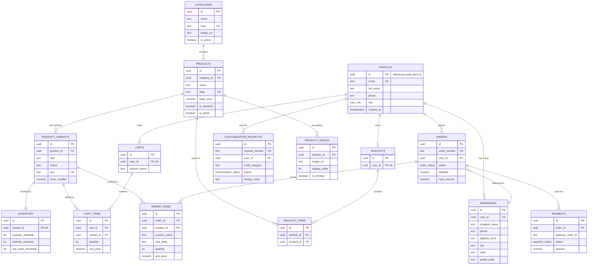

# DHEERA — Database Architecture & Entity Relationship Diagram (ERD)

This document details the PostgreSQL relational schema implemented for **DHEERA — Apparel & Lifestyle** on **Supabase**.

---

## 1. Entity-Relationship Diagram (ERD)

---

## 2. Table Specifications

### 2.1 Identity & Customer
- **`profiles`**: Linked 1:1 with Supabase `auth.users`. Contains customer role (`customer`, `admin`, `staff`), contact numbers, and default address references.
- **`addresses`**: Indian postal shipping & billing addresses with recipient details, PIN code, and default selection flags.

### 2.2 Catalogue & Merchandise
- **`categories`**: Top-level collections (Kurta Sets, Sarees, Suits, Dupattas).
- **`products`**: Master product catalogue entity with base price, compare price, descriptions, care details, and SEO metadata.
- **`product_images`**: Multi-image editorial gallery for each product supporting primary flags and display ordering.
- **`product_variants`**: Specific SKU combinations for size and colour.
- **`inventory`**: Stock tracking with reserved quantity protection and low stock alerts.

### 2.3 Shopping & Ordering
- **`carts` & `cart_items`**: Dual-mode cart supporting authenticated customer accounts and guest sessions via tokens.
- **`wishlists` & `wishlist_items`**: Dedicated customer wishlist entities.
- **`orders` & `order_items`**: Immutable records of placed orders with financial subtotal, taxes, shipping fees, and address snapshots.
- **`payments`**: Razorpay transaction lifecycle tracking (`created`, `authorized`, `captured`, `failed`).

### 2.4 Bespoke Atelier
- **`customization_requests`**: Dedicated workflow for bespoke Indian outfits, measurements, reference imagery, quotes, and artisan consultation tracking.
